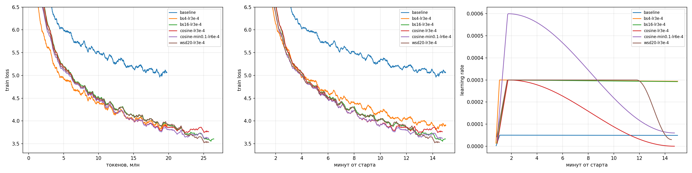
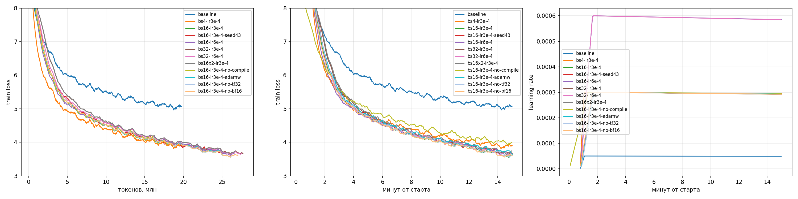
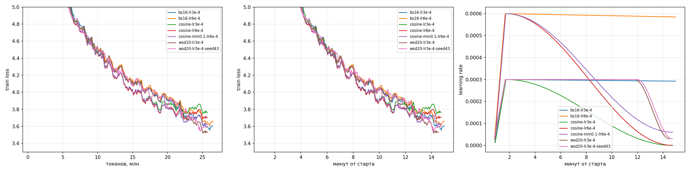

# ДЗ-1. Мини-претрейн Qwen3 1B

База это модель из шаблона с батчем 4 и lr 5e-5, eval_loss 5.724. Параметры менял по очереди и оставлял то, что улучшает результат. torch.compile, fused AdamW, bf16 и tf32 в шаблоне уже включены, их проверял выключением по одному. Два конфига повторил с другим сидом, разброс между сидами 0.02-0.06, меньшие разницы считаю шумом.

| шаг | eval_loss |
|---|---|
| шаблон, батч 4, lr 5e-5 | 5.724 |
| lr 3e-4 | 4.547 |
| батч 16 | 4.272 |
| расписание WSD | 4.241 |

На графиках слева train loss по токенам, в середине по времени, справа LR.

## Learning rate

- lr 3e-4 вместо 5e-5 при батче 4: 4.547 против 5.724, самый большой выигрыш
- при батче 16: 3e-4 даёт 4.272, 6e-4 даёт 4.335, разница на границе шума, оставил 3e-4

## Batch size и gradient accumulation

- батч 4 даёт 4.547, батч 16 даёт 4.272, батч 32 даёт 4.301
- батч 16 успевает пройти 26.5 млн токенов, батч 4 только 19.8 млн
- батч 16 с накоплением 2 даёт 4.336, это та же партия что батч 32, но чуть медленнее
- памяти хватает, накопление не нужно

## torch.compile

- без компиляции 2234 шага вместо 3237, eval_loss 4.602 против 4.272
- компиляция занимает около 47 секунд, но ускоряет обучение на 45%

## Оптимизатор

- adamw_torch даёт 4.336, adamw_torch_fused даёт 4.272
- fused проходит на 6% больше шагов, по loss разница на границе шума

## bf16 и tf32

- без bf16 autocast 4.253, без tf32 4.287, обе разницы в пределах шума
- веса в шаблоне уже в bf16, поэтому эти флаги почти ничего не меняют

## Расписание LR

- в шаблоне linear растянут на целую эпоху, поэтому LR почти не меняется, для расписаний задавал max_steps по реальной скорости
- косинус до нуля хуже постоянного LR: 4.479 против 4.272 при пике 3e-4, 4.410 против 4.335 при пике 6e-4
- в конце LR слишком маленький, и модель учится заметно медленнее
- косинус до 10% от пика даёт 4.328, на уровне постоянного LR
- WSD, постоянный LR и спад до 10% на последних 20% шагов, даёт 4.241, лучший результат
- на сиде 43 WSD 4.265 против 4.333 у постоянного LR, в среднем лучше на 0.05

## Итог

- лучший ран wsd20-lr3e-4: батч 16, lr 3e-4, WSD, torch.compile, fused AdamW
- eval_loss 4.241 и perplexity 69.5 против 5.724 и 306.2 у шаблона
- все раны в results/table.md

## Генерации

Промпт "Нейронные сети".

- шаблон: "Нейронные сети — деревня в Пемском районе Вологодской области России. Входит в состав Яского сельского поселения."
- лучший ран: "Нейронные сети — бадминальные функции, характеризующие все системы в этой области."

Модель выучила, как выглядит статья Википедии, но фактов не знает и путает согласование слов. Модель из шаблона на три промпта из четырёх пишет про деревню. Остальные генерации в results/summary.md.

## Выводы

1. Сильнее всего влияет lr, 5e-5 из шаблона слишком маленький.
2. Дальше важна скорость: батч 16 вместо 4 и torch.compile.
3. Лучше всего работает долгий постоянный LR с коротким спадом в конце, косинус до нуля хуже.
