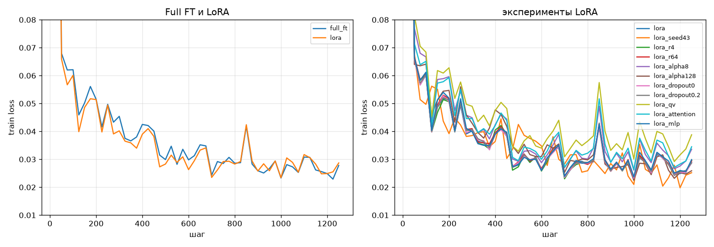

# ДЗ-4. LoRA и полный fine-tuning

База это Qwen2.5-1.5B-Instruct без дообучения. Задача text-to-SQL на датасете b-mc2/sql-create-context: по схеме таблицы и вопросу написать SQL запрос

## Данные

- выбрал text-to-SQL, потому что ответ короткий и его легко проверить автоматически, а у базы низкий EM и есть запас для роста
- убрал дубли, перемешал с сидом 42, взял 20000 примеров на обучение и 1000 на тест, данные одни для всех моделей
- пример: в таблице table_name_81 колонки overall_record и week, вопрос Can you tell me the Overall Record that has the Week of 3, ответ SELECT overall_record FROM table_name_81 WHERE week = 3
- ещё 10 примеров с ответами всех моделей в results/samples.md

## Метрики

- SQL EM: доля ответов, совпавших с эталоном после приведения регистра, пробелов и кавычек. Основная метрика, прямо меряет задачу
- SQL valid: доля запросов, которые выполняются в sqlite на схеме примера. Ловит выдуманные колонки и ошибки синтаксиса
- MMLU: точность на 1000 вопросах. Показывает, не забыла ли модель общие знания после дообучения

## Обучение

- общее: 1 эпоха, батч 16, cosine, warmup 3%, bf16, gradient checkpointing, max_length 512, loss только на ответе
- Full FT: lr 1e-5, веса и состояния Adam в fp32
- LoRA: lr 2e-4, r 16, alpha 32, dropout 0.05, адаптеры на q, k, v, o, gate, up, down

## Результаты

Тест 1000 примеров, сравнение с базой. Время и память замерены в одном запуске

| модель | SQL EM | SQL valid | MMLU | обучаемые параметры | время | пик памяти |
|---|---|---|---|---|---|---|
| база | 0.466 | 0.962 | 0.570 | | | |
| Full FT | 0.836 | 0.979 | 0.560 | 1544M | 7.5 мин | 32.3 GiB |
| LoRA | 0.826 | 0.978 | 0.563 | 18.5M | 7.1 мин | 16.7 GiB |

- обе модели почти вдвое подняли SQL EM
- Full FT и LoRA равны в пределах шума, повтор LoRA с другим сидом это подтверждает
- MMLU просел не больше чем на пункт
- LoRA обучает 1.2% параметров и берёт вдвое меньше памяти, потому что не хранит градиенты и состояния Adam для всех весов
- по времени разницы почти нет, forward и backward всё равно идут через всю модель

## Ручная оценка

Первые 10 примеров теста, плюс если запрос вернёт нужный ответ на настоящих данных

| модель | 1 | 2 | 3 | 4 | 5 | 6 | 7 | 8 | 9 | 10 | верно |
|---|---|---|---|---|---|---|---|---|---|---|---|
| база | + | + | + | − | + | − | + | − | ± | + | 6 |
| Full FT | + | + | + | − | + | + | + | − | ± | + | 7 |
| LoRA | + | + | + | + | + | − | + | − | ± | + | 7 |

- база часто права по смыслу, но пишет в своём стиле с AS и лишними условиями, поэтому EM её занижает
- обученные модели пишут как в датасете и повторяют даже битый эталон в примере 8
- Full FT в примере 4 посчитал COUNT вместо значения, LoRA в примере 6 взяла несуществующие колонки

## Эксперименты с LoRA

От основного конфига менял один параметр, тест тот же

| эксперимент | r | alpha | dropout | слои | параметры | SQL EM | MMLU |
|---|---|---|---|---|---|---|---|
| основной | 16 | 32 | 0.05 | все | 18.5M | 0.826 | 0.563 |
| сид 43 | 16 | 32 | 0.05 | все | 18.5M | 0.828 | 0.561 |
| r 4 | 4 | 32 | 0.05 | все | 4.6M | 0.822 | 0.553 |
| r 64 | 64 | 32 | 0.05 | все | 73.9M | 0.817 | 0.563 |
| alpha 8 | 16 | 8 | 0.05 | все | 18.5M | 0.798 | 0.569 |
| alpha 128 | 16 | 128 | 0.05 | все | 18.5M | 0.825 | 0.536 |
| dropout 0 | 16 | 32 | 0 | все | 18.5M | 0.815 | 0.563 |
| dropout 0.2 | 16 | 32 | 0.2 | все | 18.5M | 0.819 | 0.559 |
| q и v | 16 | 32 | 0.05 | q, v | 2.2M | 0.789 | 0.571 |
| attention | 16 | 32 | 0.05 | q, k, v, o | 4.4M | 0.797 | 0.569 |
| MLP | 16 | 32 | 0.05 | gate, up, down | 14.1M | 0.815 | 0.554 |

- сиды расходятся на 0.2 пункта, разницы меньше пункта считаю шумом
- SQL valid у всех около 0.98, ошибки смысловые, а не синтаксические

### r

- от 4 до 64 качество в пределах шума, хватает r 4
- alpha оставлял 32, поэтому вместе с r менялся и масштаб обновления

### alpha

- alpha 8 недоучивает модель за одну эпоху, loss в конце выше
- alpha 128 по SQL как 32, но MMLU падает сильнее всего

### dropout

- от 0 до 0.2 разница на границе шума, за одну эпоху модель не переобучается

### target_modules

- качество растёт с числом обучаемых параметров
- MLP полезнее attention, адаптеры на всех слоях лучше всего

## Выводы

1. Full FT и LoRA дают одно качество, общие знания почти не теряются
2. LoRA обучает 1.2% параметров и берёт вдвое меньше памяти, по времени на этой модели почти не выигрывает
3. Здесь лучше LoRA, адаптер весит десятки мегабайт против 3 GB у полной модели
4. В LoRA важнее всего alpha и выбор слоёв, r и dropout почти не влияют

## Код

- lora.py: данные, обучение и оценка, запуск python lora.py all results
- report.py: собирает таблицы и график из results
- requirements.txt: версии библиотек
